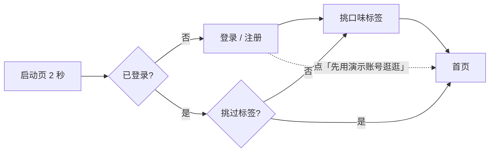
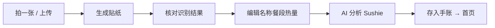

# Sushine 食物手账 · 用户使用手册

> 版本：v1.1（课程项目演示版）
> 适用：桌面浏览器 Chrome / Edge 最新版，手机浏览器（iOS Safari / Android Chrome）
> 一句话：**拍一张照片，顺手记下这餐吃了什么，还把它做成贴纸攒进手账里。**

**🌐 在线地址（免安装，手机电脑都能直接开）**

```
https://kk123-arch.github.io/sushine/
```

> 这个地址是 GitHub Pages 的静态站点：界面、贴纸、周报、体重、运动、打卡全部可用，
> 但**没有后端**，AI 写备注 / 追问会降级为本地规则，看图识别退化为「本地估算」。
> 想看完整真实 AI，请用下面「方式 A」在本地起服务。

---

## 目录

1. [它是什么](#1-它是什么)
2. [快速开始](#2-快速开始)
3. [界面与导航](#3-界面与导航)
4. [记录一餐（主流程）](#4-记录一餐主流程)
5. [首页：今天的手账](#5-首页今天的手账)
6. [周报与月度记录](#6-周报与月度记录)
7. [减脂三件套：体重 / 运动 / 打卡](#7-减脂三件套体重--运动--打卡)
8. [我的（设置与数据）](#8-我的设置与数据)
9. [贴纸收藏](#9-贴纸收藏)
10. [AI 能力边界](#10-ai-能力边界)
11. [数据与隐私](#11-数据与隐私)
12. [常见问题 FAQ](#12-常见问题-faq)
13. [界面适配说明](#13-界面适配说明)
14. [快捷键与手势](#14-快捷键与手势)

> 本版新增：在线地址、三种启动方式对比（2.1）、线上/本地能力差异（10.1）、
> 浏览器按域名隔离数据（11）、FAQ Q11–Q13（线上 AI / 白屏 / 数据不同步）。

---

## 1. 它是什么

Sushine 是一款「**食物手账 + 减脂助手**」网页应用。它把每天的三餐变成一张张可收藏的贴纸，同时把热量、营养、体重、运动串成一条能看趋势的线。

**能做的事**

| 模块 | 你能得到什么 |
| --- | --- |
| 拍照记账 | 上传一张餐照，自动识别是什么菜、估出热量和六项营养 |
| 贴纸生成 | 把照片做成带白边的「模切贴纸」，可切换 4 种画风，可下载成图片 |
| 手账首页 | 今天吃了什么一目了然，可编辑、可删除 |
| 周报 / 月报 | 7 天热量柱状图、营养结构、最常吃、一句话小结；月历回看 |
| 减脂主线 | 体重流水 + 个性化热量目标 + 运动消耗 + 净摄入 + 连续打卡 |
| AI 助手 | 依据你这一餐和今天的摄入回答「晚饭吃什么」「我盐吃多了吗」 |
| 账号 | 本机注册登录、口味标签、多账号各用各的 |

> **说明**：这是课程项目的演示版本。识别与 AI 都真实调用（见第 10 节），但账号、数据不联网同步，全部存在你自己的浏览器里。

---

## 2. 快速开始

### 2.1 启动

**三种跑法，按需要选：**

| 方式 | 怎么开始 | 完整 AI | 适合 |
| --- | --- | --- | --- |
| **A 开发模式** | `npm run dev` | ✅ | 答辩演示、想看到真识别 |
| **B 构建产物** | `npm run build` → 双击 `dist/index.html` | ❌ | 完全离线、无 Node 环境 |
| **C 在线地址** | 直接打开 `https://kk123-arch.github.io/sushine/` | ❌ | 发给老师同学、手机随时看 |

**方式 A：开发模式（推荐，功能最全）**

在 `sushine` 目录下执行：

```bash
npm install        # 第一次需要，装依赖
npm run dev        # 启动开发服务器
```

终端会打印一个本地地址（通常是 `http://localhost:5173/`），浏览器打开即可。

> 如果 5173 被占用，可以指定端口：`npm run dev -- --port=5180`。
> 注意必须写成 `--port=5180`（带等号），写成 `--port 5180` 会被 npm 吞掉参数。

**方式 B：打开构建产物**

```bash
npm run build      # 生成 dist/
```

双击 `dist/index.html` 即可离线打开（用了 hash 路由，不需要服务器）。

> ⚠️ 方式 B 下，涉及服务端的两项功能（DeepSeek 文本生成、模型文件代理）不可用，会自动降级为本地估算，其余功能正常。

**方式 C：直接打开在线地址**

```
https://kk123-arch.github.io/sushine/
```

- 电脑、手机、平板都能开，不需要装 Node，也不需要同一 Wi-Fi
- 首次加载可能慢几秒（GitHub Pages 在国内速度不稳定），刷新一下通常就好
- 与方式 A 一样会降级：没有后端，AI 两个功能不可用
- **数据存在你自己浏览器的 localStorage 里**，与本地 `localhost` 那份是**两份独立数据**（见第 11 节）

### 2.2 第一次进入



**① 启动页**
停留约 2 秒自动进入下一步；**点任意位置立即跳过**。

**② 登录 / 注册**

| 操作 | 说明 |
| --- | --- |
| 注册 | 需要填「昵称 / 邮箱 / 密码」，密码至少 6 位 |
| 登录 | 邮箱 + 密码 |
| 显示 / 隐藏 | 密码框右侧的按钮可以切换明文 |
| 忘记密码？ | 演示版没有找回流程，会提示「密码随便填就行（至少 6 位）」 |
| **先用演示账号逛逛** | 一键进入，不用注册，适合直接看功能 |

登录状态会记住，下次打开直接进首页。

**③ 挑口味标签**

- 从「清淡 / 重口 / 甜食 / 高频外卖…」等标签池里选，**最少 2 个、最多 6 个**
- 选不够时按钮是灰的，下方会提示「再选 N 个就能继续」
- 「🎲 换一批」重新抽一轮，**已经选中的不会被清掉**
- 不想挑也可以直接点右下角「完成，开始记录」，之后在「我的 → ✨ 我的标签」补

---

## 3. 界面与导航

### 底部 / 侧边 5 个入口

| 入口 | 位置 | 作用 |
| --- | --- | --- |
| **Today** | 最左 | 首页手账 |
| **日历** | 第二 | 月度记录 |
| **拍一张** | 中间凸起（橘色） | 进入拍照 / 上传 |
| **Sushie** | 第四 | AI 分析页 |
| **我的** | 最右 | 个人中心 |

- 手机上在**底部悬浮**，中间快门凸起。
- 屏幕宽度 ≥ 768px 时变成**左侧竖导航**，并多出品牌区和「拍一张」文字按钮。
- 聚焦型页面（拍照 / 贴纸生成 / 核对信息 / 编辑）为了不分散注意力，**不显示导航**，用左上角「‹」或「✕」返回。

### 全站通用的三个小细节

- 每页左上角「‹」= 返回上一页。
- 底部弹出的轻提示（Toast）1.6 秒后自动消失。
- 有二次确认的操作（删除、清空）一定先弹窗问一次。

---

## 4. 记录一餐（主流程）



### 4.1 选图：三种上传方式

在拍照页（`/#/camera`）有四种拿图的方式：

| 方式 | 操作 |
| --- | --- |
| 快门 | 点中间圆形按钮，用的是**内置演示餐照**（演示版未调用真实摄像头） |
| 上传照片 | 点「上传照片」按钮，或右侧相册图标，打开本地文件选择器 |
| 拖拽 | 把图片文件直接拖进取景框，框会变橘色并提示「松手，用这张图」 |
| 粘贴 | 截图后按 `Ctrl + V`（Mac 为 `Cmd + V`）直接贴进来 |

**限制**：只接受 `jpg / png / webp / gif` 等图片格式，单张不超过 **15 MB**；不符合会给出提示而不是静默失败。

**没有合适的照片？** 点取景框下方的「识别不准？手动记一餐」，直接进入编辑页手填，不生成贴纸（用虚线占位）。

### 4.2 生成贴纸：4 种画风

生成后可以在贴纸页底部切换风格，**切换是即时重画**，不会重新上传：

| 风格 | 效果 | 适合 |
| --- | --- | --- |
| **原图贴纸**（默认） | 真实照片，只做轻微锐化和提透 | 想要「照片 + 白边」那种清爽感 |
| **水彩** | 保边平滑 + 多主色，边缘柔和，掺回一点原图 | 想要手账的柔和观感 |
| **剪纸** | 强力平滑 + 只有 8 种颜色，边缘硬切 | 想要设计感强的块面 |
| **像素** | 缩小再用最近邻放大，复古颗粒感 | 想要怀旧风 |

四个风格共同的一步：**智能抠边 + 白色模切边**，成品是透明背景，像从贴纸册上撕下来的一张。

页面底部操作：

| 按钮 | 作用 |
| --- | --- |
| ✕ | 重拍，回拍照页 |
| ✓（圆形 shutter） | 确认贴纸，进入核对信息 |
| 右下角裁切图标 | 打开面板：「从相册选择」/「重新拍一张」 |
| 直接把图拖到页面上 | 换图并重画 |

### 4.3 核对识别结果

进入贴纸信息页后，页面会显示：

- 识别出的**菜名 + emoji + 置信度**
- **热量**（大字号，点一下就能改）
- **六项营养**：碳水 / 蛋白质 / 脂肪 / 纤维 / 糖 / 盐（每项都是真实输入框）
- 一张**便利贴**，可以写点什么（如「加班回家随手煮的」），会随记录一起保存

顶部会标明识别来源：

| 提示文案 | 含义 |
| --- | --- |
| 贴纸已生成 · AI 已识别 | 服务端视觉模型识别成功 |
| 贴纸已生成 · 本地模型识别 | 浏览器本地视觉模型识别成功（结果可靠，只是慢一点） |
| 贴纸已生成 · 本地估算 | 模型不可用时按菜名规则估算（差异最大，建议手动核对） |

**首次使用本地模型会下载约 146 MB**，页面会显示「首次要下载视觉模型 42%（146MB，只需一次）」这样的进度，下载完成后同一张图只要 2–3 秒。详见 [FAQ](#12-常见问题-faq)。

页面按钮：

| 按钮 | 作用 |
| --- | --- |
| ✕ | 放弃这一餐，回首页 |
| ✓ | 下一步，进入编辑 |
| 右上角 ⤓ | **存成贴纸图片**：导出 540×640 PNG（贴纸 + 名称 + 备注 + 水印），可直接发到社交平台 |

### 4.4 编辑与保存

编辑页可以最后微调：

| 项目 | 操作 |
| --- | --- |
| 菜名 | 文本输入，改完立刻同步到贴纸上的文字 |
| 餐段 | 早 / 午 / 晚 / 加餐 切换 |
| 热量 | 左右 ± 按钮，每次 10 kcal |
| 贴纸 | 点贴纸 = 重新拍一张 |
| 备注 | 可继续编辑 |

点「保存」后：Toast「已存入手账」→ 自动跳转到 Sushie 分析页。

### 4.5 AI 分析（Sushie）

分析页会给这一餐一段口语化点评，例如「这餐蛋白质够，油偏多，晚饭清淡一点就好」。

| 按钮 | 作用 |
| --- | --- |
| 展开 / 收起 | 展开该餐的六项营养明细 |
| 撤销 | 真的把这条记录从手账删掉并回首页 |
| 查看 | 跳到周报的「今日」视图 |
| ↗ | 把分析文字复制到剪贴板 |
| ⋯ | 打开菜单：「🔄 重新分析」/「删除这条记录」 |

**底部输入框可以和 Sushie 对话**，它会带着「你这一餐 + 今天的累计摄入」来回答。可以问：

- 「晚饭吃什么」
- 「我今天盐吃多了吗」
- 「这餐热量算高吗」

AI 回答通常一两句话、≤120 字；连不上网络时会回落到本地规则答案，不会卡住。

---

## 5. 首页：今天的手账

首页自上而下是四块：

**① 日期条**——本周 7 天，点任意一天切换。
> 目前只有「今天」有真实记录，切到其他日期会显示「这一天还没有记录」并给你一个拍照入口（演示数据限制）。

**② 体重卡**——显示最新体重、较上周变化、目标进度和一条小折线，点整张卡进入「身体数据」。

**③ 打卡卡**（虚线卡，两行）

```
🔥 连续 14 天  🏅 1 枚            [ 今天打卡 ]
─────────────────────────────────────────────
🏃 今日消耗 0 kcal                运动记录 ›
```

- 点「今天打卡」→ Toast「打卡成功 · 连续 15 天 🎉」，按钮变描边「✓ 今天已打卡」
- 第二行点进去是运动记录页
- 详见 [7.3 每日打卡](#73-每日打卡)

**④ 餐卡列表**——每一餐一张卡片，显示时间、贴纸、菜名、备注、标签和热量

| 操作 | 效果 |
| --- | --- |
| 点卡片 | 打开该餐的核对/详情页（可改可看营养） |
| 点右上角「⋯」 | 菜单：编辑 / 删除（删除即时生效并提示） |
| 点右上角「📊 周报」 | 直接进周报 |
| 点右上角头像 | 进入「我的」 |

**空状态**：这一天没记东西时显示一张虚线贴纸 + 「今天还没记录 / 拍下第一餐，从这一刻开始」。

---

## 6. 周报与月度记录

### 6.1 周报（`/#/report`）

顶部两个分段：**今日 / 本周**，默认是「本周」。三个入口：

- 首页右上角「📊 周报」
- 「我的 → 📊 本周周报」
- Sushie 分析页的「查看」

**本周报四块内容**

| 区块 | 内容 |
| --- | --- |
| 四宫格概览 | 本周总热量 / 日均 kcal / 记录天数 / 未超目标天数 |
| 每日热量 | 7 根柱子，**超过目标的标橙**，今天描边高亮；底部一行「本周运动消耗 X kcal · 净摄入 Y kcal」 |
| 营养结构 | 碳水 / 蛋白质 / 脂肪 的**热量占比**和克数 |
| 最常吃 | 出现次数最多的 4 样，如「番茄鸡蛋面 ×2」 |
| 一句话小结 | 自动生成，如「本周记了 7 天，日均 1449 kcal，差不多一半的日子在目标内」 |

其它按钮：

- 「⟳」刷新并提示「已同步最新记录」
- 「＋ 记下一餐」直接进拍照

> 目标热量不是写死的，来自你在「身体数据」里的身高体重和减重速度。改了资料，周报的目标线会立刻跟着动。

### 6.2 月度记录（`/#/month`）

- 「‹ ›」真正翻月（本月 / 上个月 / 下个月都能翻）
- 有记录的日子点了跳到周报看那一天
- 空白日子点了会弹「要现在拍一张吗」，确认后进拍照
- 右侧是贴纸日历，可以按日期回看这一天的贴纸

---

## 7. 减脂三件套：体重 / 运动 / 打卡

入口都在「我的」里，也可以从首页卡片直达。

### 7.1 体重与目标（`/#/body`）

**顶部打卡栏**：`🔥 连续 N 天 · 今天已/未打卡`，未打卡时右侧有「打卡」按钮。

**记录体重**

| 操作 | 说明 |
| --- | --- |
| 输入框 + 「− / ＋」 | 每次 ±0.1 kg |
| 「记录今天」 | 写入当天流水；效果见下方 |
| 「删除今天的记录」 | 删掉当天这条 |

记录成功后，**整站会连锁更新**：

- 折线图多一个点
- 目标进度百分比变化
- 基础代谢（BMR）、日常消耗（TDEE）、**每日建议摄入**重新计算
- 周报的目标线跟着变
- 当天自动算作**已打卡**

**个性化目标怎么来的**

| 指标 | 算法 |
| --- | --- |
| 基础代谢 BMR | Mifflin-St Jeor 公式（按身高、体重、年龄、性别） |
| 日常消耗 TDEE | BMR × 活动系数（久坐 1.2 / 轻度 1.375 / 中度 1.55 / 高强度 1.725） |
| 每日建议摄入 | TDEE − 减重缺口（每周 −0.5 kg ≈ 每天少 550 kcal） |
| 预计达成 | 剩余公斤数 ÷ 每周速度，换算成具体日期 |

**安全下限保护**：建议摄入不会低于 **女 1200 / 男 1500 kcal**。如果你选了「每周 −1 kg」把数字压到下限以下，页面会出现警告条，说明这个速度太激进。

**可改的资料**：身高、年龄、性别、目标体重、活动量、减重速度。改完立即生效，不需要保存按钮。

### 7.2 运动记录（`/#/activity`）

**页面结构**

1. **今日消耗大字** + 一行公式：`吃进去 1240 − 动掉 107 = 1133 kcal 净摄入`
2. **8 种运动类型**：🚶 走路 / 🏃 跑步 / 🚴 骑行 / 🏋️ 力量 / 🏊 游泳 / 🧘 瑜伽 / 🪢 跳绳 / 🏸 球类
3. **分钟数**：− / + 每次 5 分钟，右侧实时显示「≈ 107 kcal」
4. **「记下」** 写入今日列表
5. **今天的运动**：列表形式，每条带 ✕ 可删（删完热量与净摄入立刻回退）
6. **近 7 天消耗**：柱状图 + 合计

**消耗怎么算**：`MET 系数 × 体重(kg) × 时长(小时)`。例如走路 MET 3.5、体重 61.2 kg、30 分钟 → 约 107 kcal。

> 这是估算值。实际消耗和强度、心率、体质都有关系，页脚也写了「当参考就好」。

### 7.3 每日打卡

两个地方都能打：

| 位置 | 操作 |
| --- | --- |
| 首页打卡卡 | 点橘色「今天打卡」按钮 |
| 身体数据页顶部 | 点「打卡」按钮；或点「记录今天」称重（称重自动算打卡） |

**规则**

- 每天最多算一次，重复点只会提示「今天已经打过卡了」
- **连续天数**从今天往回数，直到断掉为止；今天还没打卡时从昨天开始数，所以不会一进首页就变成 0
- 「🏅 N 枚」是里程碑徽章：**每减掉 1 kg 解锁一枚**
- 连续天数在首页和身体数据页都会显示，是个纯心理激励，不影响其它计算

---

## 8. 我的（设置与数据）

`/#/profile`，顶部是你的昵称、头像（昵称首字母）和口味标签。

| 入口 | 作用 |
| --- | --- |
| 🔔 用餐提醒 | 开关（演示版只存状态，不会真的推送通知） |
| 🌿 无压力模式 | **全站隐藏热量数字**，只显示「已记录 N 餐」，进度条也收起。适合不想被数字绑架的时候 |
| 📘 导出手账 | 下载 `sushine-handbook-<时间戳>.json`，含应用名、用户名、导出时间和全部记录 |
| 🏷 我的贴纸 | 进入贴纸收藏面板 |
| ⚖️ 体重与目标 | 进身体数据页，右侧显示当前体重 |
| 🏃 运动记录 | 进运动记录页，右侧显示今日消耗 |
| 📊 本周周报 | 进周报 |
| ✨ 我的标签 | 重新挑口味标签（还是最少 2 个） |
| ⚙️ 设置 | 底部面板：📋 复制为文本 / 🗑 清空本机手账 / 关于 |
| 退出登录 | 退出账号；**手账数据留在本机**，换账号登录还能看到 |

> 「无压力模式」是全局开关，首页、周报、Sushie 的热量都会隐藏，不是只关一个页面。

---

## 9. 贴纸收藏

`/#/collection`（我的 → 🏷 我的贴纸）

- 顶部三个筛选胶囊：**全部 / 今日手账 / 月度月历**
- 贴纸按 `auto-fill` 网格排列，大屏一行能放更多
- 点任意一张，带入那条记录进入详情页
- 你攒的每一餐都是一张贴纸，这是 Sushine 和普通热量 App 最大的区别

---

## 10. AI 能力边界

演示版里有的能力是**真的**，有的是**估算**，请看这张表：

| 功能 | 真实程度 | 说明 |
| --- | --- | --- |
| 看图识别菜品 | ✅ 真实 | 浏览器本地视觉模型（CLIP）跑推理，20 类候选菜品中选最像的 |
| 写备注 / 追问回答 | ✅ 真实 | 调用 DeepSeek 文本大模型，带上下文，每次结果不同 |
| 热量与六项营养 | ⚠️ 估算 | 按识别出的菜品套参考值，个体差异较大 |
| 运动消耗 | ⚠️ 估算 | MET 系数公式，不测心率 |
| 用餐提醒 | ❌ 仅开关 | 没有接入系统通知 |

**为什么看图识别要下载 146 MB？**
为了保证「不需要联网 API 也能识别」，模型是在你的浏览器里跑的，第一次用会下载并缓存，之后一直复用（同一台设备只需一次）。

**为什么 DeepSeek 不能直接看图？**
实测该 API 的对话接口不支持图片输入，因此拆成两条线：**看图交给本地视觉模型，文字交给 DeepSeek**。

### 10.1 线上版与本地版的差别

上面那张「✅ 真实」是对**本地开发模式**说的。部署到 GitHub Pages 后是纯静态站点，没有 Node 后端：

| 功能 | 本地 `npm run dev` | 在线地址 / 双击 dist |
| --- | --- | --- |
| 登录注册、贴纸生成、手账、周报月报 | ✅ | ✅ 完全一样 |
| 身体数据、运动记录、每日打卡 | ✅ | ✅ 完全一样 |
| 看图识别菜品 | ✅ 本地 CLIP | ⚠️ 会尝试直连 huggingface.co，国内多数网络失败 → 显示「本地估算」 |
| AI 写备注 / Sushie 追问 | ✅ DeepSeek | ❌ 无接口 → 回落本地规则文案 |

页面不会报错，只是顶部状态会诚实地写「本地估算」。**答辩演示用本地，分享给别人用在线地址。**

---

## 11. 数据与隐私

- **全部数据只存在你这台设备的浏览器里**（localStorage），不上传服务器。
- 用的存储键：

| 键 | 内容 |
| --- | --- |
| `sushine:journal:v1` | 手账记录 |
| `sushine:settings:v1` | 无压力模式、贴纸风格等设置 |
| `sushine:accounts:v1` | 本机注册的账号 |
| `sushine:auth:v1` | 当前登录状态 |
| `sushine:body:v1` | 体重流水 + 打卡记录 + 身体资料 |
| `sushine:activity:v1` | 运动记录 |

**这意味着**

- 清理浏览器缓存 / 换浏览器 / 换设备 / 无痕模式关掉 → 数据就没了
- 想保留：用「我的 → 📘 导出手账」保存 JSON
- 想重来：用「设置 → 🗑 清空本机手账」
- 想让演示数据回到初始状态：打开开发者工具 → Application → Local Storage → 删掉上面几个键 → 刷新
- **浏览器按「域名」隔离数据**：在线地址 `kk123-arch.github.io` 和本地 `localhost:5173` 是两套独立存储。
  在线上记的餐不会出现在本地，反之亦然；两边各自从种子数据开始（首次打开会自动生成 14 天体重流水）。

**AI 请求**：只有「写备注」和「Sushie 追问」会把**文字内容**（菜名、热量、你的问题）发给 AI 服务，图片不出本机。

---

## 12. 常见问题 FAQ

**Q1：识别出来的菜不对怎么办？**
直接改用输入框手填菜名 / 热量 / 营养，或点「识别不准？手动记一餐」跳过识别。顶部提示如果是「本地估算」，说明模型没跑起来，结果仅供参考。

**Q2：第一次识别卡在「正在看图…」很久**
是在下载 146 MB 模型。页面会显示百分比和已等待秒数。建议网络好时先随便识别一次完成下载，之后每张只要 2–3 秒。若一直失败，检查是否被浏览器隐私插件拦截了本地模型文件请求。

**Q3：为什么周报上的「未超目标」总是 0？**
说明你记的热量普遍高于目标。目标由身体数据推出来（默认约 1335 kcal），可以在「身体数据 → 减重速度」里调，或核对是不是某几餐热量填高了。

**Q4：看不到任何热量数字了**
大概率开了「我的 → 🌿 无压力模式」，关掉即恢复。

**Q5：首页打卡按钮一直是灰的「✓ 今天已打卡」**
说明今天已经打卡过了（称过体重也算）。想重看效果：开发者工具删掉 `sushine:body:v1` 后刷新。

**Q6：连续天数怎么才算断？**
某一天既没称重也没点打卡，这一天之后的天数就重新从 1 开始。

**Q7：退出登录后我的记录还在吗？**
在。手账数据是本机的，账号只决定「显示谁的名字和标签」。

**Q8：跑起来端口被占用**
`npm run dev -- --port=5180`（等号不能省）。

**Q9：双击 `dist/index.html` 后 AI 不能用**
静态文件没有 dev 服务端代理。用 `npm run dev` 启动才能用真实 AI。

**Q10：贴纸太模糊 / 太卡通**
在贴纸页切换风格，默认的「原图贴纸」是最接近真实照片的。像素风和水彩风会刻意损失细节。

**Q11：在线地址上的 AI 为什么只显示「本地估算」？**
因为 GitHub Pages 只能托管静态文件，没有 Node 后端，`/api/ai`、`/api/recognize`、`/api/model` 这些接口不存在。
前端的降级策略是：问不到就退回本地规则，页面照常能用。想看真 AI 请用 `npm run dev`。

**Q12：在线地址打开很慢或白屏怎么办？**
GitHub Pages 在国内网络不稳定。先按 `Ctrl + F5` 强制刷新；仍不行就换个网络（手机热点）或改用本地运行。
如果是白屏且控制台报资源 404，说明部署产物有问题，去仓库 Actions 页面看最近一次构建是否成功。

**Q13：在线版和本地版的数据会同步吗？**
不会。浏览器按域名隔离存储，两处各自独立。需要搬数据可以用「我的 → 📘 导出手账」导出 JSON。

---

## 13. 界面适配说明

同一套代码三档形态，**不需要缩放浏览器**：

| 屏幕宽度 | 形态 | 导航 | 内容 |
| --- | --- | --- | --- |
| < 768px | 手机 | 底部 Tabbar（中间凸起快门） | 单列全宽 |
| 768 – 1199px | 平板 | 左侧 244px 竖导航 | 单列，自适应 |
| ≥ 1200px | 桌面 | 左侧竖导航 | 居中 940–1080px，首页双列、周报双列、月历左右分栏 |

- 聚焦流程页（拍照、贴纸、核对、编辑）在大屏会收窄成 560–660px 的居中工作区，图片不会被拉得过大。
- 手机模拟状态栏只在 < 768px 显示。

---

## 14. 快捷键与手势

| 操作 | 效果 |
| --- | --- |
| `Ctrl + V` / `Cmd + V` | 在拍照页粘贴剪贴板里的图片 |
| 拖拽图片到取景框 | 用这张图 |
| 拖拽图片到贴纸页 | 换图并重画贴纸 |
| 点击启动页任意位置 | 跳过 2 秒等待 |
| 点热量 / 营养数字 | 直接变成输入框 |

---

## 附：一页速查

**网址**：https://kk123-arch.github.io/sushine/ →
完整 AI 请本地跑 `npm run dev`（详见 2.1）

```
登录 → 挑标签 → 首页
记一餐：中间快门 / 上传 / 拖拽 / 粘贴 → 选风格 → 核对数字 → 保存 → AI 点评
看进度：首页体重卡 / 打卡卡 / 周报 / 月报
管目标：我的 → 体重与目标（改资料 → 建议摄入自动变）
动起来：我的 → 运动记录（选类型 + 分钟 → 记下 → 净摄入下降）
每天：首页点「今天打卡」→ 连续天数 +1
```

有任何用不明白的地方，先翻第 12 节 FAQ，那里覆盖了 90% 的「点了没反应」。
